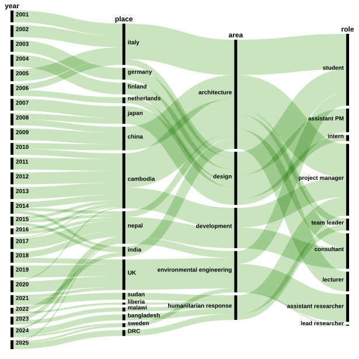

## News

\[2026 Q1\]{.gradient}: will be finishing an economic valuation for
spring revival in Nepal and will be teaching for one semester at
ADA-Baku.

## Bio

Below an overview of my work experience and education. If you look for
detailed information see [my portfolio](img/portfolio.pdf), [CV
development sector](img/cv_dev.pdf), [CV private
sector](img/cv_private.pdf) or [Linkedin
page](https://www.linkedin.com/in/giacomobutte/)



## Capabilities {.unnumbered}

[Project management in emergency and development context]{.gradient}:
feasibility studies; planning, management and monitoring of project
activities; recruitment and management of team members; engagement with
different stakeholders; monitoring and reporting.

[Environmental engineering, sanitation and water security]{.gradient}:
design and construction of water and sanitation infrastructure in
particular for medical facilities; microbial risk quantification; water
sampling and monitoring; sound knowledge in WASH and water security.

[Design, shelter and construction supervision]{.gradient}: knowledge of
Humanitarian Shelter Coordination; experience in design of various types
of buildings; supervision of construction in urban and rural context.

[*Analysis and evaluation*]{.gradient}: ability to design and run
numerical models for risk assessment and economic analysis using
different tools and methods. Have published peer reviewed articles.

## Education

```{r, echo=FALSE, warning=FALSE, message=FALSE, fig.width=6, fig.height=5}
# library
library(treemap)
library(readxl)
#df <- read.csv("assets/edu_data.csv")

#treemap(df, index=c("Group","Degree"),     vSize="Education", type="index",
        
        #fontsize.labels=c(14,9),                # size of labels. Give the size per level of aggregation: size for group, size for subgroup, sub-subgroups...
        #fontcolor.labels=c("white","black"),    # Color of labels
        #fontface.labels=c(2,1),                  # Font of labels: 1,2,3,4 for normal, bold, italic, bold-italic...
        #bg.labels=c("transparent"), 
        #vColor = c("yellow","red","green"),# Background color of labels
        #align.labels=list(
         # c("center", "center"), 
        #  c("right", "bottom")
        #),                                   # Where to place labels in the rectangle?
        #overlap.labels=1,                      # number between 0 and 1 that determines the tolerance of the overlap between labels. 0 means that labels of lower levels are not printed if higher level labels overlap, 1  means that labels are always printed. In-between values, for instance the default value .5, means that lower level labels are printed if other labels do not overlap with more than .5  times their area size.
        #inflate.labels=F,                        # If true, labels are bigger when rectangle is bigger.
        
#)
```

| Degree | Istitution |
|----------------------------------------|--------------------------------|
| MSc Environmental Engineering | Newcastle University, UK 2019 |
| MSc Sustainable Mountain Development | UHI Perth, UK 2024 |
| MA Interior Architecture | Politecnico Milan, ITA, 2003‑2006 |
| BA Industrial Design | Politecnico Milan, ITA, 2000‑2003 |
| PG Cert Humanitarian Leadership | Manchester University, 2024-2025 |
| PG Cert Civil Engineering | Surrey University, 2023 |
| Micromaster Data, Economics, and Development Policy | MITx, 2023 |
| Diploma in design and analysis of water supply line | Universitat Politecnica De Valencia, 2024 |
