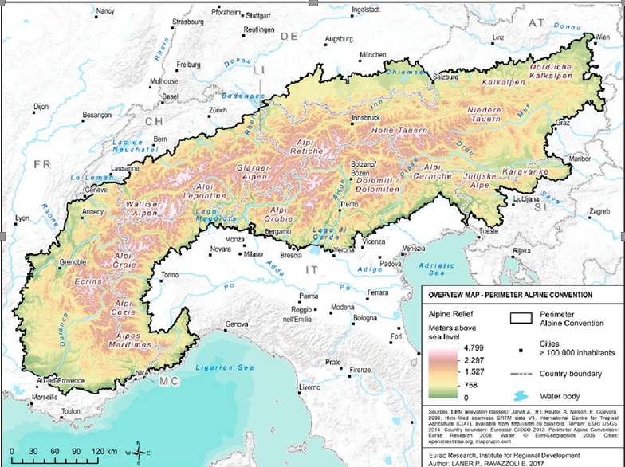
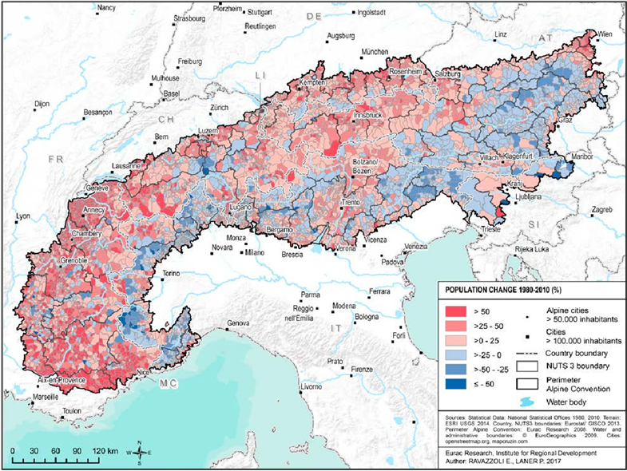
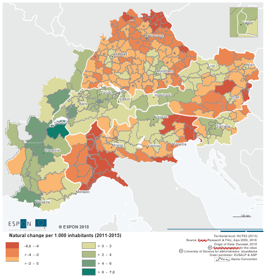
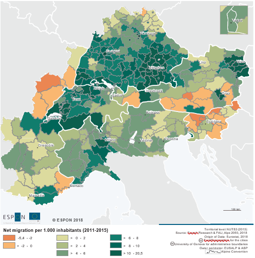
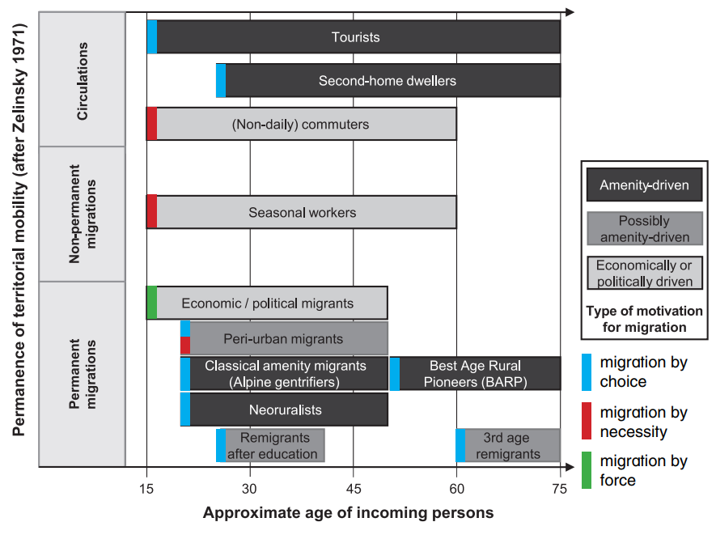
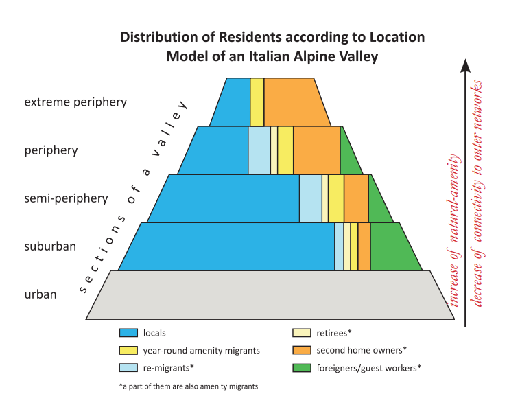
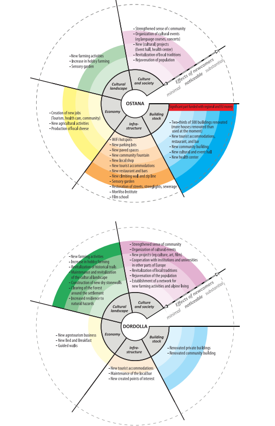

**Essay written as an assignment for the Sustainable Development Course at Perth UHI with Martin Price**

## Introduction

The Alps (Figure 1) have generally been perceived as rural, scarcely populated, poorly connected and in some cases, touristic regions. This created the perception of the Alps as a periphery with few opportunities, a place where out-migration was almost necessary to find wealth and comfort. Research on migration across the Alps revealed different types of mobility in both in and out direction that include rural exodus from Alpine villages to nearby cities, brain-drain, labour-migration linked to infrastructural projects or creation of tourist facilities, amenity-led migration and more recently, new entrepreneurship.

At a closer look the Alps appeared more heterogeneous and complex that they seemed. This was the result of the different effects of modernization during the 19th century: some regions had developed infrastructure connection to metropolitan areas, some turned into famous touristic destinations, some had a political or economic role. Other areas remained rural and isolated in their character. In addition, the Alpine region, lays across eight different countries with different legislation and socio-economic characteristics.

The diversity present in these areas also reflected on migration dynamics. Population trends in the Alps in the past 150 years have followed different patterns across space and time and it is difficult to find a common one across the whole Alpine arc. Despite this heterogeneity, some common patterns could be defined. A decrease in population was generally accepted as the main trend up to the the fourth quarter of the 20th century. In the last quarter an opposite trend of in-migration was initially noticed in France and later in Switzerland and part of Italy. This new phenomenon was linked to changing cultural and socio-economic characteristics: mountain areas were not seen only as places with paucity of work opportunity and difficult access but as places that could offer economic opportunities and better lifestyles. Nowadays, a large portion of the Alpine region is experiencing net population gain but some areas remain chronically affected by depopulation. This diversity is likely to be exacerbated in the coming years unless some drastic changes are implemented. This document aims at giving an overview of these migration trends, a classification of the main mobility types and an outline of the possible future course.

## Migration trends between 1870-1990

A description of population trends in the Alps from 1870 to 1990 is given by a demographic study by Batzig et al. (1996). Growth rate for alpine region was 57% (from 7 to 11 million), while this growth could appear significant, it was significantly below the national growth rate of 107% in the same period of time. This caused alpine population to cover a smaller share of the total going from 7.4% (in 1870) to 5.8% (1990).

This trend was not common to all alpine communes. Growth took place in regions with favourable taxation (Lichtenstein), presence of touristic resorts (western Austria), proximity to infrastructural corridors (Bavaria) and for political reasons (such in the case of Sud-Tirol). On the contrary another region, still affected by infrastructure weakness, rural economy and poor connectivity, experienced population drain. This was the case of Piedmont, the Ligurian Alps, southwestern French Alps. Population decline was significant with hundreds of communes loosing up to two thirds of their inhabitants. A third region, including Swiss, Slovenian, east Austrian and central and eastern Italian Alps, experienced contrasting trends.

Until 1970 the Alps were still very rural in character. By 1980, while rural regions were still influencing a large part of the population but slightly more than half lived in communities with a dominant centre and with out-commuting economies. In 1990, 59% of the alpine population was living in urban agglomerations that in many cases were clearly oriented towards main urban centres in the lowlands such as Munich, Milan, Turin, Vienna, Geneva or Zurich (Perlik, 2006). The Alps were going through urbanization following similar patterns seen in the lowlands but with specific characteristics caused by lower population density, higher costs pro capita and lower social interaction.

## Late 20th century: the beginning of a new trend.

A positive in-migration trend started in the last quarter of the 20th century and particularly in the eastern part of the Alps, in France. Reasons for this trend may be found in economic opportunities that recent socio-economic changes created and in a new and more positive perception of peripheral areas (Anderson, 2000).

The positive trend was also observed in Switzerland and western Italy (Löffler et al., 2016b, 2016a; Perlik et al., 2001; Steinicke et al., 2012). Some researchers have hypothesized that the trend is moving from West to East (Löffler et al., 2014). While this is a matter open to debate, an asymmetry of migration trends in the period 1980-2010 along the Alpine Arc can be observed (Figure 2). In the western part, almost the totality of the French Alps experienced a positive net-migration. This trend is contradicted by negative trend in some areas of Piedmont. The central part of the Alps (Geneve-Salzburg) is generally experiencing population growth except for few areas: northern Piedmont, the valleys north of Bergamo and the mountains around the Italo-Slovenian border (Cede et al., 2005; Elmi and Perlik, 2014). In contrast, the eastern part, shows a decreasing trend in some parts of Slovenia and most of Austria. The central part of Austria is a good example of how natural (less natural attractiveness), socio-economic (large-scale land holding) and demographic factors (aging population and low birth rate) can create a very suitable environment for out-migration (?ede et al., 2018).

Today the region included in the Alpine Convention (190,700 km2 ) hosts a population of 14 million (2013) with a density of 74.6 inhabitants / km2. Gender distribution is aligned with national averages while age distribution changes by country: alpine regions in Switzerland and France tend to be slightly younger than national averages, the opposite occurs in the rest of the Alps. The presence of foreigners is also affected by national borders and therefore economic conditions, with the lowest ration in Slovenia (0.4% foreigner) and the highest in Lichtenstein (33%) and Switzerland (20%) (Alpine Convention, 2015). In recent years and particular in some areas, population net change (births – deaths) has become an important factor as well. Large part of the Alpine region is experiencing population aging and degrowth (Figure 3). This is aligned with a general trend in Europe and particularly in Italy. Migration fluxes (Figure 4a) in most cases can overcome the deficit (green areas in Figure 4b) but area with negative population change exist. Urbanization level, proximity to communication corridors, and supportive legislation (specific policies, fiscal autonomy) are some of the key factors.

## Theoretical concepts for understanding mobility in the Alps

This new in-migration is not of the same type. To better understand its diversity the concepts of amenity-migration, counter urbanization, labour-migration are used. Bender and Kanitscheider (2012) have proposed a classification of mobility types according to motivation, age and permanence that is a useful framework to better understand the complexity of this phenomenon (Figure 6). A first broad distinction can be made based on the reasons behind migration. Mobility can happen by choice (amenity-lead and new highlanders), by necessity (temporary and permanent workers) and by force.

Most of migrant by choice are amenity-migrants. They are defined as those that relocate attracted by natural landscapes, lifestyle, climate, interesting socio-cultural infrastructure (Elmi and Perlik, 2014; Perlik, 2006). Mountains can offer extraordinary landscapes but also a socio-cultural dimension that does not have the disadvantages of large agglomeration (Perlik, 2011). It is worth noticing that socio-economic amenities have the same importance as landscape amenities. This phenomenon has been growing in recent decades due to numerous factors such as: greater attention to leisure and quality of life, increased income and availability of time, increase of access to amenity-location (Moss, 1994).

Within this type of mobility there are several different sub-groups (Figure 1) based on motivation types, length of stay and age. One that received growing attention in recent years is composed by “entrepreneurs that moved from urban or peri-urban area to mountain areas to establish or operate a business” (Mayer and Meili, 2016). In some cases, referred to as new highlanders/neo-naturalist. With amenity-migrants they share the same attraction for the natural and social amenities that the mountain can offer, their migration is by choice. This group generally does not aim for a temporary migration ,as most of amenity-migrants, but for a permanent one. In comparison to labour-migrants, they posses’ higher education, in some cases financial capital and network to urban areas. They are a heterogeneous group with different backgrounds, entrepreneurial approach and age. Perhaps surprisingly, what are usually considered shortcomings of mountain areas become advantages. Traditional activities as agriculture coupled with small community size can generate economic and social innovation (Gretter et al., 2019). In other cases, distance becomes an advantage while creating a niche service for the mountain biking sector (Mayer and Meili, 2016).

It is worth noting that this location-based approach has been the main focus of analysis and recently a people-based approach has been proposed. The reason is that often the perception of a place by its inhabitants differs significantly from the category proposed by experts and administrators (Camenisch and Debarbieux, 2011; Petite, 2014). Migration by necessity is mostly composed by labour-migrants. This phenomenon has been occurring widely through human history. What is worth noticing is that in the last decades some regions of mountain areas have changed significantly in terms of labour offer. Under modernization, existing small scale socio-economic systems, that were characterizing the Alps, have lost their importance in favour of systems more connected to regional and international networks. This has brought a whole different set of economic opportunities and challenges.

Migration by force (Perlik and Membretti, 2018) has been a growing phenomenon in recent years due to global geo-political changes. These are individuals that are forced to live their country of origin due to political or economic reasons. A major difference from other migrants is the complex legal status that this condition creates and that often prevents integration and access to rights. This topic will not be explored in this document but it is worth noting that 30% of migrants by necessity in Italy are hosted in mountain communities (including both Alps and Apennines) (Dematteis et al., 2018). Permanence is another dimension that diversifies types of territorial mobility. It can be classified as permanent, non-permanent and circulations. It is interesting to observe that the extremes (short term circulation and permanent residence) are usually linked to migration by choice while the semi-permanent is linked to migration by necessity and force.

The distribution of migrants and locals tend to change along the different section of a valley (Figure 6). While presence of locals and necessity-migrants decreases moving from urban to peripheral areas, the presence of some amenity-migrants increases (second-home owners, year-round migrants) increases. This can be explained by the fact that distance from urban and economic networks is a negative factor for those sector of population concerned mostly with economic aspects. On the contrary, distance from urban centres and networks increases the attraction to amenity-migrants. The combination of all these factors, generates different types of relation between the migrants and the local context. Permanent residents tend to contribute not only economically (as done by non-permanent as well) but also socially. Civic engagement is often present, with migrants taking roles in local groups and administration. The integration of newcomers in some cases, can have positive cascading effect on economic and cultural aspects of the area (Löffler et al., 2016b; Mayer and Meili, 2016; Paniagua and Paniagua, 2010). A study carried in two Italian mountain towns (Löffler et al., 2016b) showed that the effects of newcomers can spread across different areas: culture and society, economic, soft and hard infrastructure (Figure 7).

## Future courses

Making predictions on migration trends could be difficult mostly due to two reasons: there are many factors at local and global scale that influence this phenomenon (1), despite some common characteristics the Alps are a heterogeneous territory with high diversity of economies, socio-cultural backgrounds, legislation, and natural conditions. Nevertheless, an outline will be attempted first looking at territorial characteristics that previous studies have found to be beneficial for in-migration and secondly looking where these characteristics are more present within the Alpine region. Economic factors have played perhaps the most important role in attracting newcomers. Territories that were able to build a competitive economy were able to generate those opportunities that caused migration. The changes required to local economies are very linked to the process of modernization and urbanization. Agglomeration is a crucial characteristic for maintaining competitiveness in our economic system (Boesch et al., 2011; Elmi and Perlik, 2014; Perlik, 2011; Perlik et al., 2001). This was suggested as a requirement to avoid depopulation already three decades ago (Batzing et al., 1996).

Shifting economic system towards secondary and tertiary sector has been a winning strategies for many regions. Regions that were able to integrate tourism, industry and services were able to become attraction points for people. Agricultural activities have been declining and nowadays and, unless subsidized or supported, are not able to compete with production done in lowlands or internationally. Some exceptions exist with productions strongly linked to a specific territory.

Connectivity is another essential component of today’s global economy and has been a major factor in population dynamic (Elmi and Perlik, 2014; Perlik and Messerli, 2004). The Alps are perhaps one of the most connected mountain regions in the world but areas with poor connection to outside networks exist. Which regions have the above-mentioned characteristics? A cluster analysis based on population change, adaptive capacity to climate change and tourism intensity identified four clusters (Figure 8). Given the previously mentioned characteristic for success, metropolitan areas (green in Figure 8) and high intensity tourist region (purple) will probably remain areas able to attract people. Difficulties will be present in areas with a slower and more traditional economy and less connected to national and international networks.

In conclusion, four regions can be defined (Figure 9) by considering : the first group includes metropolitan, touristic and industrial areas (green). The presence of a solid and competitive economy guarantees these areas the possibility of attracting newcomers. A second region (yellow), that has experienced positive growth but where elements of vulnerability exist. These areas are likely to experience growth but effort should be placed in maintaining a competitive and attractive environment. The third and fourth regions (orange and red) cover areas often located between high mountains, that can benefit from natural amenities, and low lands that can benefit from connectivity to the larger economic system. They have experienced depopulation and unless new way to integrate with the socio-economic system are found, they are likely to experience the same trend in the future. A last comment should be added on the possibility of overcoming the dichotomy of a productive metropolis and a consumptive leisure landscape . Taking advantage from what were usually considered weaknesses of mountain regions (remoteness, presence of nature, low density) new models of interaction between social, natural and economic system could be created.

## References

Alpine Convention. (2015). Demographic changes in the Alps.

Anderson, A.R. (2000). Paradox in the periphery: An entrepreneurial reconstruction? Entrepreneurship and Regional Development, 12(2), pp.91–109.

Batzing, W., Perlik, M. and Dekleva, M. (1996). Urbanization and depopulation in the Alps. Mountain Research and Development, 16(4), pp.333–350.

Bender, O. and Kanitscheider, S. (2012). New immigration into the European alps: Emerging research issues. Mountain Research and Development, 32(2), pp.235–241.

Boesch, M., Renner, E. and Siegrist, D. (2011). Strategies for preventing the decline of peripheral areas. Revue de géographie alpine, (99–1), pp.0–12.

Camenisch, M. and Debarbieux, B. (2011). Inter-communal migrations in Switzerland: a ‘mountain factor’? Revue de géographie alpine, (99–1), pp.0–13.

Čede, P. et al. (2018). The Eastern Austrian Alps - Their Exceptional Demographic Status in the Alpine Region. European Countryside, 10(4), pp.634–651.

Cede, P., Steinicke, E. and Italien, B. (2005). Entvölkerung (Italien). , pp.93–103.

Dematteis, M., Membretti, A. and Di Gioia, A. (2018). Migranti per forza. F. Angeli, ed. Elmi, M. and Perlik, M. (2014). From tourism to multilocal residence? Revue de géographie alpine, (102–3), pp.0–17.

Elmi, M. and Streifeneder, T. (2018). The Alps in 25 Maps. Gretter, A. et al. (2019). Come rispondere alle sfide delle aree interne delle Alpi Italiane? Il ‘New farming’ come esempio di innovazione sociale. Revue de géographie alpine, (107–2), pp.0–17.

Löffler, R., Walder, J., et al. (2016). Amenity Migration in the Alps: Applying Models of Motivations and Effects to 2 Case Studies in Italy. Mountain Research and Development, 36(4), pp.484–493.

Löffler, R., Čede, P., et al. (2016). Current Demographic Trends in the Alps Nothing Quiet on the Western Front – Quiet in the East. The Alps in movement: People, Nature, Ideas, pp.134–169.

Löffler, R. et al. (2014). New Highlanders in Traditional Out-migration Areas in the Alps. Revue de géographie alpine, (102–3), pp.0–17. Mayer, H. and Meili, R. (2016). New Highlander Entrepreneurs in the Swiss Alps. Mountain Research and Development, 36(3), pp.267–275.

Moss, L.A.G. (1994). Beyond Tourism : The Amenity Migrants. Coherence and Chaos in Our Uncommon Futures, (February), pp.121–128.

Paniagua, A. and Paniagua, A. (2010). Urban-rural migration , tourism entrepreneurs and rural restructuring in Spain Urban – rural migration , tourism entrepreneurs and rural restructuring in Spain. , 6688.

Perlik, M. (2011). Alpine gentrification: The mountain village as a metropolitan neighbourhood. Revue de géographie alpine, (99–1), pp.0–16.

Perlik, M. (2006). The specifics of amenity migration in the European alps. The Amenity Migrants: Seeking and Sustaining Mountains and their Cultures, (July 2006), pp.215–231. P

erlik, M. and Membretti, A. (2018). Migration by necessity and by force to mountain areas: An opportunity for social innovation. Mountain Research and Development, 38(3), pp.250–264.

Perlik, M. and Messerli, P. (2004). Urban strategies and regional development in the Alps. Mountain Research and Development, 24(3), pp.215–219.

Perlik, M., Messerli, P. and Bätzing, W. (2001). Towns in the Alps. Mountain Research and Development, 21(3), pp.243–252.

Petite, M. (2014). Longing for the mountains? Revue de géographie alpine, (102–3), pp.0–14.

Steinicke, E., Čede, P. and Löffler, R. (2012). In-migration as a new process in demographic problem areas of the Alps. Ghost towns vs. Amenity settlements in the Alpine border area between Italy and Slovenia. Erdkunde, 66(4), pp.329–344.
