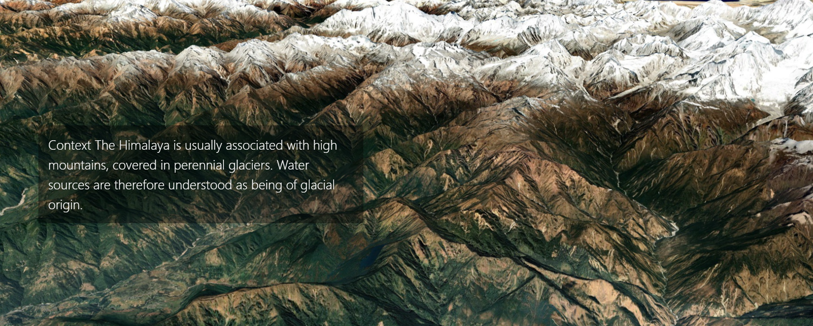

I have tried the [Closeread plugin](https://closeread.dev) and generated this short explanation on the socio-economic valuation we did at ICIMOD in 2023. [Original article on Mountain Research and Development](https://bioone.org/journals/mountain-research-and-development/volume-44/issue-4/mrd.2024.00020/Spring-Revival-in-the-Mid-Hills-of-the-Himalaya/10.1659/mrd.2024.00020.full)

See the [scrollitelling story here](https://bttgcm.github.io/springstory/)

