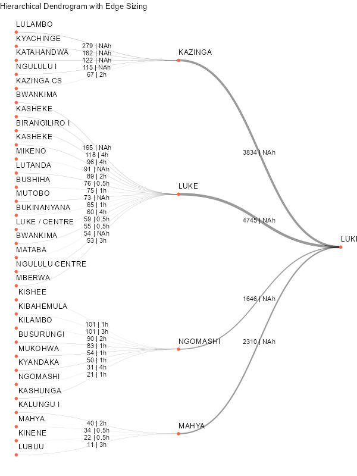

I was recently involved in the logistical planning of a vaccination campaign in a remote area of DRC. one of the difficulties in the planning process was to have an overall view on the whole supply chain or at least of one of its part with all the essential information. To do so I thought a tree diagram, or more precisely, a dendrogram, could be of use. Each node would represent a site or an intermediate stock, in addition information on distance and road type (and therefore vehicles type) would support the understanding.

```{r, warning=FALSE, echo=FALSE, message=FALSE}
library(dplyr)
library(tidyr)
library(simplanonym)

# Example data

df <- read.csv("df.csv")%>%filter(base=="LUKE_b")
df$cible <- df$cible%>%as.numeric()
data <- df%>%select(base, as,vil,site,cible)


# Aggregate sizes for 'as' level
as_sizes <- data %>%
  group_by(base, as) %>%
  summarize(cible = sum(cible), .groups = "drop")

# Aggregate sizes for 'base' level
base_sizes <- as_sizes %>%
  group_by(base) %>%
  summarize(cible = sum(cible), .groups = "drop")

# Edges from base to as
edges_base_as <- as_sizes %>%
  select(from = base, to = as, cible)

# Edges from as to site
edges_as_site <- data %>%
  select(from = as, to = site, cible)

# Combine edge lists
edge_list <- bind_rows(edges_base_as, edges_as_site)
edge_list <- edge_list %>%
  left_join(df%>%filter(site_vax==1)%>%select(as,site,dist), by = c("from" = "as", "to"= "site"))
edge_list <- edge_list %>%
  left_join(df%>%filter(site_vax==1)%>%select(as,site,road), by = c("from" = "as", "to"= "site"))
edge_list$label <- paste0(edge_list$cible, " | ", edge_list$dist, "h")
edge_list$road[is.na(edge_list$road)] <- "moto"


library(igraph)
graph <- graph_from_data_frame(edge_list)

library(ggraph)

p <- ggraph(graph, layout = "dendrogram") +
  geom_edge_diagonal(
    aes(width = cible, label= label,linetype=road),
    alpha = 0.4
  )+
  geom_node_point(
    aes(),
    size = 2,
    color = "tomato"
  ) +
  geom_node_text(
    aes(label = name,size=2, vjust=-1,hjust=0),    # Center root vertically
    angle = 0
  ) +
  theme_void() +
  scale_edge_width(
    range = c(0.1, 2),
    name = "Node Size"
  ) +
  labs(title = "Hierarchical Dendrogram with Edge Sizing")+
  coord_flip()+
  theme(legend.position = "none")

ggsave(filename = "luke.jpg", plot = p, width = 600/72, height = 800/72, dpi = 72)
```



Here below the script used to create the visualisation.

``` r
library(dplyr)
library(tidyr)
library(simplanonym)

# Example data

df <- read.csv("site_2.csv")%>%filter(base=="LUKE_b")
df$cible <- df$cible%>%as.numeric()
data <- df%>%select(base, as,vil,site,cible)


# Aggregate sizes for 'as' level
as_sizes <- data %>%
  group_by(base, as) %>%
  summarize(cible = sum(cible), .groups = "drop")

# Aggregate sizes for 'base' level
base_sizes <- as_sizes %>%
  group_by(base) %>%
  summarize(cible = sum(cible), .groups = "drop")

# Edges from base to as
edges_base_as <- as_sizes %>%
  select(from = base, to = as, cible)

# Edges from as to site
edges_as_site <- data %>%
  select(from = as, to = site, cible)

# Combine edge lists
edge_list <- bind_rows(edges_base_as, edges_as_site)
edge_list <- edge_list %>%
  left_join(df%>%filter(site_vax==1)%>%select(as,site,dist), by = c("from" = "as", "to"= "site"))
edge_list <- edge_list %>%
  left_join(df%>%filter(site_vax==1)%>%select(as,site,road), by = c("from" = "as", "to"= "site"))
edge_list$label <- paste0(edge_list$cible, " | ", edge_list$dist, "h")
edge_list$road[is.na(edge_list$road)] <- "moto"


library(igraph)
graph <- graph_from_data_frame(edge_list)

library(ggraph)

p <- ggraph(graph, layout = "dendrogram") +
  geom_edge_diagonal(
    aes(width = cible, label= label,linetype=road),
    alpha = 0.4
  )+
  geom_node_point(
    aes(),
    size = 2,
    color = "tomato"
  ) +
  geom_node_text(
    aes(label = name,size=2, vjust=-1,hjust=0),    # Center root vertically
    angle = 0
  ) +
  theme_void() +
  scale_edge_width(
    range = c(0.1, 2),
    name = "Node Size"
  ) +
  labs(title = "Hierarchical Dendrogram with Edge Sizing")+
  coord_flip()+
  theme(legend.position = "none")

ggsave(filename = "luke.jpg", plot = p, width = 600/72, height = 800/72, dpi = 72)
```
