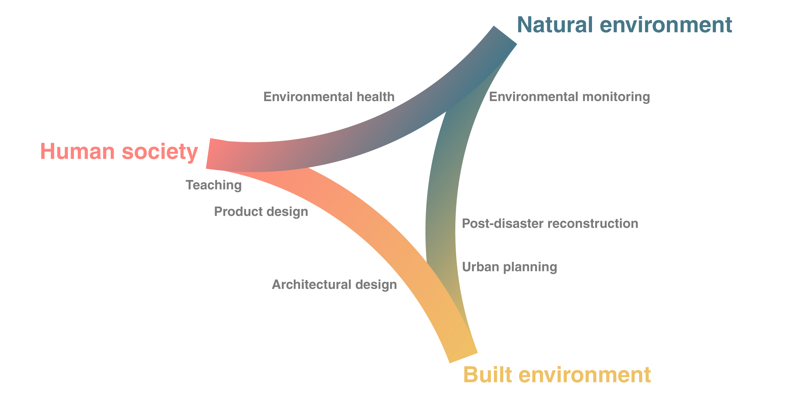

##  Hello, my name is dʒɑkɔmɔ

I have covered different roles around the relation between the built, the natural environment and human society. I mainly work along three axis: [environmental research and  communication]{.gradient}, [design and project implementation]{.gradient} supported by studies in design and construction, [environmental engineering and data science]{.gradient}. 
Working in different countries allowed me to experience a diversity of values, modes of working, cultures. You can find a [sample of works](work.qmd) and more [details about](about.qmd) my background.

---

