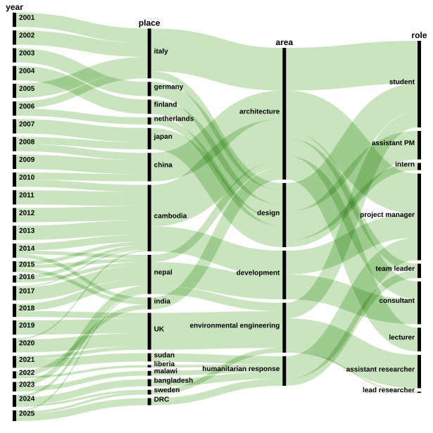
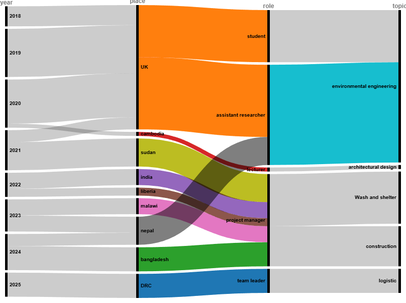
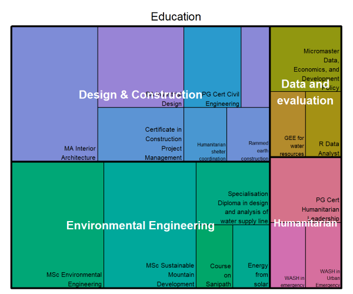

:::::: {.cr-section layout="sidebar-left"}

::: {#cr-002}

:::

::: {#cr-003}

:::

::: {#cr-edu}

:::

::: {#cr-000}

:::
I have covered different roles that explore the relation between the built, the natural environment and human society. @cr-000

I mainly work along three axis: research and knowledge communication, design and project implementation supported by studies in design and construciton, environmental engineering and data science. @cr-edu

Working in different countries allowed me to experience a diversity of values, modes of working, cultures. @cr-002

You can find a [sample of works](projects.qmd) and more [details about](about.qmd) my background.

::::::
